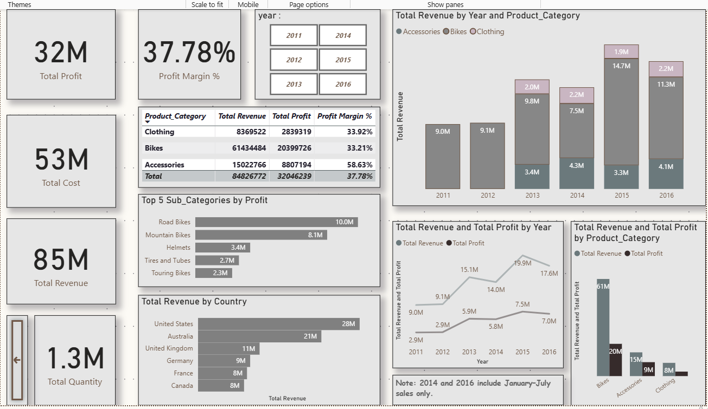

# Sales Performance Analysis | 2011 – July 2016

## Overview
An end-to-end sales analysis project. I cleaned and validated a sales dataset, built a Power BI dashboard, and cross-checked the key numbers in Excel.

## Business Questions
- Which product categories and sub-categories bring the most revenue and profit?
- Which countries are the strongest markets?
- How did sales change from year to year?

## Tools
- Power BI Desktop: data cleaning (Power Query Editor), DAX measures, dashboard
- Excel (web): validation, PivotTable, verification log

## Dataset
- Sales transactions from 2011 to July 2016
- 6 countries and 3 product categories (Bikes, Accessories, Clothing)
- 112,036 rows after cleaning

## Data Cleaning and Validation
- Removed 1,000 duplicate rows (112,036 rows remain); the same result in Power BI and Excel
- Checked data types, dates, and numeric columns
- Confirmed Revenue = Cost + Profit in all rows
- Kept 58 rows with negative profit as recorded
- Total Revenue (84,826,772) and Total Profit (32,046,239) match in both tools
- All checks are recorded in the Verification_Log sheet

## Key Insights
1. Total revenue is 84.8M with 32.0M profit, a 37.78% profit margin.
2. Bikes drive the business: 72% of revenue and about 64% of profit, at a 33.2% margin.
3. Accessories have the highest margin (58.6%) but only 18% of revenue.
4. Road Bikes and Mountain Bikes together earn 18.1M, over half of total profit.
5. The United States (28M) and Australia (21M) account for more than half of revenue.
6. 2014 and 2016 have no sales from August to December, so full-year totals are not comparable.
7. In 2013 and 2015, 72% and 69% of yearly revenue came between August and December, versus about 44% in 2011 and 2012.
8. Accessories and Clothing have no recorded sales in 2011–2012. About 90% of the revenue increase from 2012 to 2013 came from these two categories.

## Limitations
- 2016 data ends in July.
- Year-to-year growth should be read with care because of missing months and new categories.

## Files
- Sales_Analysis_Portfolio.pbix: Power BI report (Insights and Dashboard pages)
- Sales22_Editable.xlsx: data, data quality sheet, PivotTable, Verification_Log

Author: Esraa Nagy
